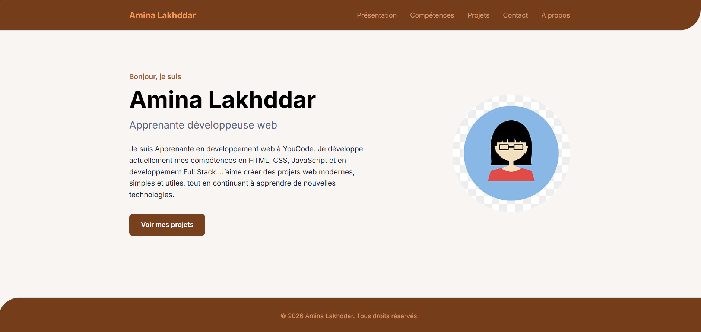
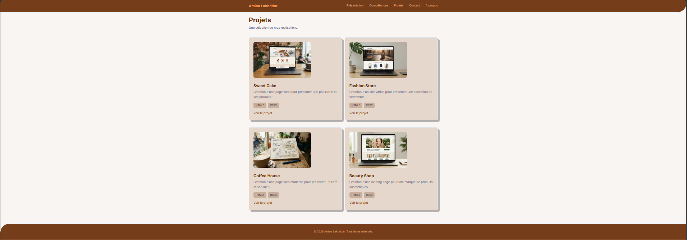
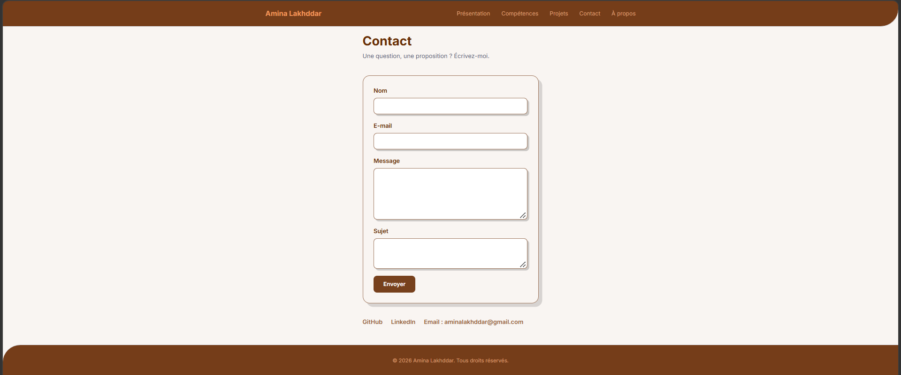
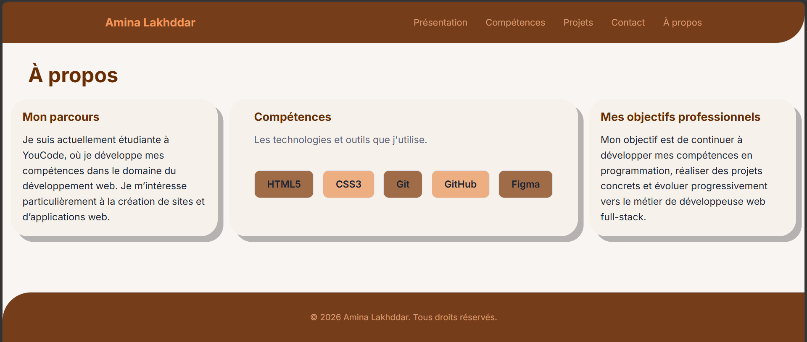

# Portfolio — Amina lakhddar

Ce projet est un portfolio personnel. Il permet de présenter mon parcours, mes compétences, mes projets et mes objectifs professionnels et de me contacter  .

## Lien de Figma 
https://www.figma.com/design/n30hmEUY6lwiGyMNE2tJqB/portfolio?node-id=5-183&t=y9isvjN5kGVRUNou-0

## Contenu

- `index.html` : la page Présentation
- `propos.html` : la page À propos
- `projets.html` : la page Projets
- `contact.html` : la page Contact
- `css/style.css` : la feuille de style
- `presentation.png`
- `projet.png`
- `contact.png`
- `propos.png`
- `images/` : avatar.jpg, projet-1.jpg, projet-2.jpg, projet-3.jpg, projet-4.jpg

## Technologies utilisées
- HTML5
- CSS3

## Liste des changements apportés au modèle
1. Séparation des trois pages présentation, projets et contact.
2. Remplir les infos personnels dans les pages html
3. Ajouter la page à propos
4. Styler la page à propos
5. Ajouter le champs Sujet et vérifier les types des champs et les champs sont obligatoires dans la page contact.
6. Modifier le background color des sections de la page projet et ajouter target pour les liens de reseaux dans la page contact.
7. Styler la page presentation.
8. Changer les niveaux des titres de la page à propos et styler la page projet
9. Modifier le lien des competences dans le menu
10. Ajouter l'émail à les réseaux de la page contact et la styler
11. Remplir le fichier README.md par les informations importantes avec les captures d'écran des 4 pages 

## Les captures d'écran des 4 pages

